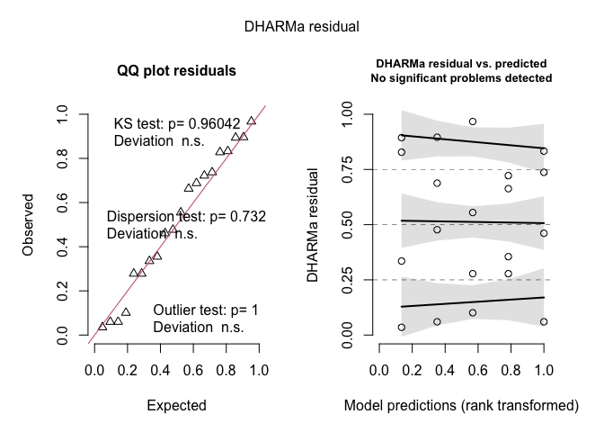
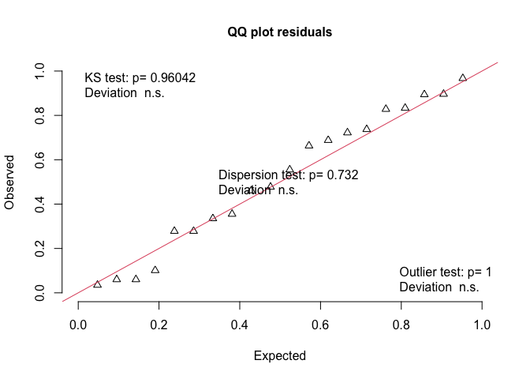
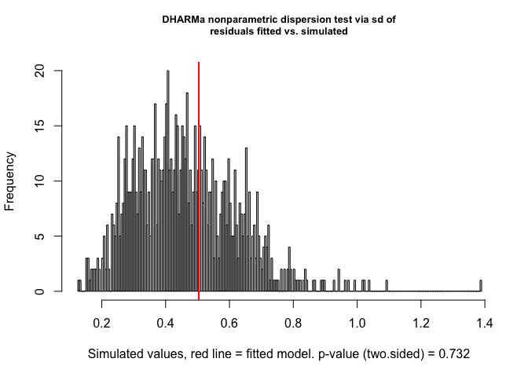
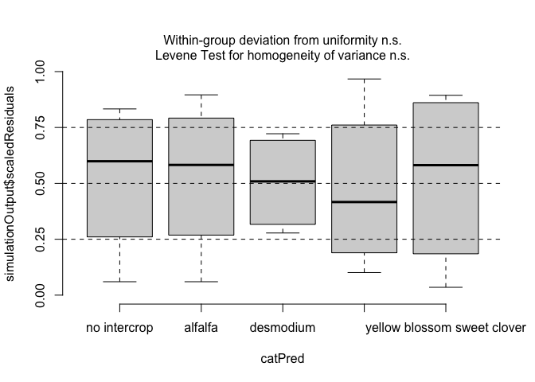
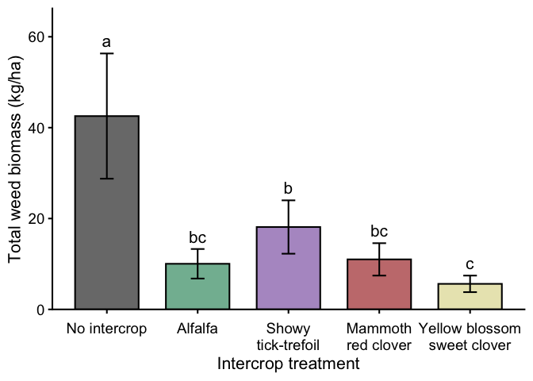

Kessler intercropping trial: Peak weed and intrecrop biomass
================

# Setup

# Packages and figure settings

``` r
# Packages

library(tidyverse)
library(janitor)
library(readxl)
library(glmmTMB)
library(DHARMa)
library(emmeans)
library(multcomp)
library(car)
library(kableExtra)
library(here)
library(conflicted)

# Handle conflicts
conflicts_prefer(dplyr::select)
conflicts_prefer(dplyr::filter)
conflicts_prefer(dplyr::recode)
conflicts_prefer(dplyr::summarise)
conflicts_prefer(dplyr::mutate)


# Treatment order
intercrop_levels <- c(
  "no intercrop",
  "alfalfa",
  "desmodium",
  "mammoth red clover",
  "yellow blossom sweet clover"
)

# Figure labels
intercrop_labels <- c(
  "no intercrop" = "No intercrop",
  "alfalfa" = "Alfalfa",
  "desmodium" = "Showy\ntick-trefoil",
  "mammoth red clover" = "Mammoth\nred clover",
  "yellow blossom sweet clover" = "Yellow blossom\nsweet clover"
)

# Treatment colors
intercrop_cols <- c(
  "no intercrop" = "#7A7A7A",              # gray
  "alfalfa" = "#82B9A0",                   # soft green
  "desmodium" = "#B49ACB",                # muted purple
  "mammoth red clover" = "#C77C7D",       # muted red
  "yellow blossom sweet clover" = "#E9E6BD" # pale yellow
)

# Default figure theme
theme_set(theme_bw(base_size = 12))
```

### Treatment effects on total weed biomass

``` r
# Data import and preparation

biomass_clean <- read_excel(
  here("data", "peak_weed_intercrop_biomass.xlsx"),
  na = c("", "na", "NA")
) |>
  clean_names() |>
  filter(!is.na(plot_id)) |>
  mutate(
    block_id = factor(block_id),
    plot_id = factor(plot_id),
    sampling_date = as.Date(sampling_date),

    intercrop_treatment = factor(
      intercrop_treatment,
      levels = intercrop_levels
    ),

    # Convert biomass from grams per sampled area to g/m2
    weed_biomass_g_m2 =
      weed_biomass_g / area_sampled_m2,

    intercrop_biomass_g_m2 =
      intercrop_g / area_sampled_m2,

    # Convert g/m2 to kg/ha
    weed_biomass_kg_ha =
      weed_biomass_g_m2 * 10,

    intercrop_biomass_kg_ha =
      intercrop_biomass_g_m2 * 10
  )

# Quick check
knitr::kable(
  biomass_clean |>
    select(
      plot_id,
      block_id,
      intercrop_treatment,
      area_sampled_m2,
      weed_biomass_g,
      weed_biomass_g_m2,
      weed_biomass_kg_ha,
      intercrop_g,
      intercrop_biomass_g_m2,
      intercrop_biomass_kg_ha
    ),
  digits = 1,
  caption = "Intercrop and weed biomass"
)
```

| plot_id | block_id | intercrop_treatment | area_sampled_m2 | weed_biomass_g | weed_biomass_g_m2 | weed_biomass_kg_ha | intercrop_g | intercrop_biomass_g_m2 | intercrop_biomass_kg_ha |
|:---|:---|:---|---:|---:|---:|---:|---:|---:|---:|
| 101 | 1 | desmodium | 0.5 | 0.7 | 1.3 | 13.0 | 0.3 | 0.6 | 5.6 |
| 102 | 1 | alfalfa | 0.5 | 1.1 | 2.2 | 22.4 | 1.8 | 3.7 | 36.6 |
| 103 | 1 | no intercrop | 0.5 | 4.0 | 8.0 | 80.2 | NA | NA | NA |
| 104 | 1 | mammoth red clover | 0.5 | 0.6 | 1.2 | 12.0 | 1.5 | 2.9 | 29.2 |
| 105 | 1 | yellow blossom sweet clover | 0.5 | 0.5 | 1.0 | 10.0 | 0.8 | 1.6 | 16.2 |
| 201 | 2 | alfalfa | 0.5 | 0.2 | 0.4 | 3.6 | 1.8 | 3.5 | 35.0 |
| 202 | 2 | yellow blossom sweet clover | 0.5 | 0.1 | 0.2 | 1.8 | 1.9 | 3.7 | 37.4 |
| 203 | 2 | mammoth red clover | 0.5 | 0.2 | 0.5 | 4.8 | 2.0 | 4.1 | 41.0 |
| 204 | 2 | desmodium | 0.5 | 1.2 | 2.5 | 25.0 | 0.3 | 0.7 | 6.6 |
| 205 | 2 | no intercrop | 0.5 | 2.0 | 4.0 | 40.4 | NA | NA | NA |
| 301 | 3 | no intercrop | 0.5 | 3.2 | 6.5 | 64.8 | NA | NA | NA |
| 302 | 3 | mammoth red clover | 0.5 | 0.4 | 0.7 | 7.2 | 1.1 | 2.2 | 21.6 |
| 303 | 3 | alfalfa | 0.5 | 0.5 | 0.9 | 9.4 | 0.7 | 1.4 | 14.4 |
| 304 | 3 | yellow blossom sweet clover | 0.5 | 0.2 | 0.4 | 4.2 | 0.8 | 1.6 | 15.8 |
| 305 | 3 | desmodium | 0.5 | 0.7 | 1.4 | 14.2 | 0.2 | 0.4 | 3.8 |
| 401 | 4 | yellow blossom sweet clover | 0.5 | 0.7 | 1.3 | 13.2 | 0.9 | 1.7 | 17.2 |
| 402 | 4 | no intercrop | 0.5 | 0.8 | 1.6 | 15.6 | NA | NA | NA |
| 403 | 4 | desmodium | 0.5 | 1.2 | 2.3 | 23.4 | 0.3 | 0.6 | 6.4 |
| 404 | 4 | alfalfa | 0.5 | 0.7 | 1.3 | 13.4 | 1.2 | 2.5 | 25.0 |
| 405 | 4 | mammoth red clover | 0.5 | 1.8 | 3.5 | 35.4 | 0.9 | 1.7 | 17.4 |

Intercrop and weed biomass

``` r
# Mixed model for total weed biomass

weed_model <- glmmTMB(
  log(weed_biomass_kg_ha) ~
    intercrop_treatment +
    (1 | block_id),
  data = biomass_clean,
  family = gaussian()
)


### Diagnostics for total weed biomass model

set.seed(123)

res_wbm <- DHARMa::simulateResiduals(
  fittedModel = weed_model,
  n = 1000
)

plot(res_wbm)
```

<!-- -->

``` r
DHARMa::testUniformity(res_wbm)
```

<!-- -->

    ## 
    ##  Asymptotic one-sample Kolmogorov-Smirnov test
    ## 
    ## data:  simulationOutput$scaledResiduals
    ## D = 0.113, p-value = 0.9604
    ## alternative hypothesis: two-sided

``` r
DHARMa::testDispersion(res_wbm)
```

<!-- -->

    ## 
    ##  DHARMa nonparametric dispersion test via sd of residuals fitted vs.
    ##  simulated
    ## 
    ## data:  simulationOutput
    ## dispersion = 1.0935, p-value = 0.732
    ## alternative hypothesis: two.sided

``` r
DHARMa::plotResiduals(
  res_wbm,
  form = biomass_clean$intercrop_treatment
)
```

<!-- -->

``` r
# Overall treatment effect

weed_anova <- car::Anova(
  weed_model,
  type = 2
)

weed_anova_table <- weed_anova |>
  as.data.frame() |>
  tibble::rownames_to_column("effect") |>
  mutate(
    effect = recode(
      effect,
      intercrop_treatment = "Intercrop treatment"
    )
  ) |>
  transmute(
    effect,
    chisq = Chisq,
    df = Df,
    p_value = format.pval(
      `Pr(>Chisq)`,
      digits = 3,
      eps = 0.001
    )
  )

knitr::kable(
  weed_anova_table,
  digits = 3,
  caption = "Overall treatment effect on total weed biomass"
)
```

| effect              |  chisq |  df | p_value |
|:--------------------|-------:|----:|:--------|
| Intercrop treatment | 25.726 |   4 | \<0.001 |

Overall treatment effect on total weed biomass

``` r
# Estimated marginal means

weed_emmeans <- emmeans(
  weed_model,
  ~ intercrop_treatment
)


# Protected Fisher's LSD pairwise comparisons

weed_pairs_table <- pairs(
  weed_emmeans,
  adjust = "none"
) |>
  summary(infer = c(TRUE, TRUE)) |>
  as_tibble() |>
  mutate(
    ratio = exp(estimate)
  ) |>
  select(
    contrast,
    log_difference = estimate,
    ratio,
    SE,
    z.ratio,
    p.value
  )

knitr::kable(
  weed_pairs_table,
  digits = 3,
  caption = "Protected Fisher's LSD comparisons for total weed biomass"
)
```

| contrast | log_difference | ratio | SE | z.ratio | p.value |
|:---|---:|---:|---:|---:|---:|
| no intercrop - alfalfa | 1.444 | 4.238 | 0.423 | 3.414 | 0.001 |
| no intercrop - desmodium | 0.853 | 2.347 | 0.423 | 2.017 | 0.044 |
| no intercrop - mammoth red clover | 1.352 | 3.865 | 0.423 | 3.197 | 0.001 |
| no intercrop - yellow blossom sweet clover | 2.024 | 7.569 | 0.423 | 4.786 | 0.000 |
| alfalfa - desmodium | -0.591 | 0.554 | 0.423 | -1.397 | 0.162 |
| alfalfa - mammoth red clover | -0.092 | 0.912 | 0.423 | -0.218 | 0.828 |
| alfalfa - yellow blossom sweet clover | 0.580 | 1.786 | 0.423 | 1.372 | 0.170 |
| desmodium - mammoth red clover | 0.499 | 1.647 | 0.423 | 1.180 | 0.238 |
| desmodium - yellow blossom sweet clover | 1.171 | 3.225 | 0.423 | 2.769 | 0.006 |
| mammoth red clover - yellow blossom sweet clover | 0.672 | 1.958 | 0.423 | 1.589 | 0.112 |

Protected Fisher’s LSD comparisons for total weed biomass

``` r
# Compact-letter display and model-estimated means

weed_cld <- multcomp::cld(
  weed_emmeans,
  alpha = 0.05,
  adjust = "none",
  Letters = letters,
  sort = TRUE,
  reversed = TRUE
) |>
  as.data.frame()

lcl_col <- intersect(
  c("lower.CL", "asymp.LCL"),
  names(weed_cld)
)[1]

ucl_col <- intersect(
  c("upper.CL", "asymp.UCL"),
  names(weed_cld)
)[1]

weed_cld_table <- weed_cld |>
  mutate(
    estimated_kg_ha = exp(emmean),
    lower_kg_ha = exp(.data[[lcl_col]]),
    upper_kg_ha = exp(.data[[ucl_col]]),
    intercrop_treatment = factor(
      intercrop_treatment,
      levels = intercrop_levels
    )
  ) |>
  arrange(intercrop_treatment) |>
  select(
    intercrop_treatment,
    estimated_kg_ha,
    lower_kg_ha,
    upper_kg_ha,
    .group
  )

knitr::kable(
  weed_cld_table,
  digits = 1,
  caption = "Model-estimated total weed biomass by treatment"
)
```

| intercrop_treatment         | estimated_kg_ha | lower_kg_ha | upper_kg_ha | .group |
|:----------------------------|----------------:|------------:|------------:|:-------|
| no intercrop                |            42.5 |        22.5 |        80.3 | a      |
| alfalfa                     |            10.0 |         5.3 |        18.9 | bc     |
| desmodium                   |            18.1 |         9.6 |        34.2 | b      |
| mammoth red clover          |            11.0 |         5.8 |        20.8 | bc     |
| yellow blossom sweet clover |             5.6 |         3.0 |        10.6 | c      |

Model-estimated total weed biomass by treatment

``` r
# Figure data

weed_plot_data <- weed_cld |>
  mutate(
    intercrop_treatment = factor(
      intercrop_treatment,
      levels = intercrop_levels
    ),

    # Back-transform model estimates from the log scale
    estimated_kg_ha = exp(emmean),

    # Approximate SE on the back-transformed scale
    se_kg_ha = exp(emmean) * SE
  ) |>
  arrange(intercrop_treatment)

# Position CLD letters above the error bars

cld_offset <- 0.05 * max(
  weed_plot_data$estimated_kg_ha +
    weed_plot_data$se_kg_ha
)

weed_plot_data <- weed_plot_data |>
  mutate(
    cld_y = estimated_kg_ha +
      se_kg_ha +
      cld_offset
  )

# Plot

weed_plot <- ggplot(
  weed_plot_data,
  aes(
    x = intercrop_treatment,
    y = estimated_kg_ha,
    fill = intercrop_treatment
  )
) +
  geom_col(
    width = 0.7,
    color = "black"
  ) +
  geom_errorbar(
    aes(
      ymin = estimated_kg_ha - se_kg_ha,
      ymax = estimated_kg_ha + se_kg_ha
    ),
    width = 0.15
  ) +
  geom_text(
    aes(
      y = cld_y,
      label = stringr::str_trim(.group)
    ),
    size = 5.5
  ) +
  scale_fill_manual(
    values = intercrop_cols,
    labels = intercrop_labels,
    drop = FALSE
  ) +
  scale_x_discrete(
    labels = intercrop_labels,
    drop = FALSE
  ) +
  scale_y_continuous(
    expand = expansion(mult = c(0, 0.12))
  ) +
  labs(
    x = "Intercrop treatment",
    y = "Total weed biomass (kg/ha)"
  ) +
  theme_classic(base_size = 16) +
  theme(
    axis.text.x = element_text(
      size = 14,
      lineheight = 0.95,
      margin = margin(t = 8)
    ),
    axis.text.y = element_text(size = 14),
    axis.title.x = element_text(size = 16),
    axis.title.y = element_text(size = 16),
    legend.position = "none"
  )

weed_plot
```

<!-- -->

``` r
# Save figure

ggsave(
  filename = here(
    "figures",
    "total_weed_biomass_model_means.png"
  ),
  plot = weed_plot,
  width = 8,
  height = 6,
  dpi = 300,
  bg = "white"
)
```
